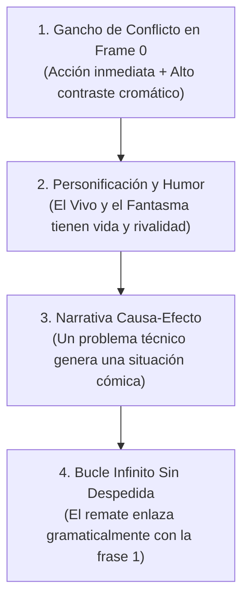

# Kinior Devlog Shorts — Fórmula de Producción y Viralidad

Esta skill reúne el estilo narrativo y el flujo de producción de Shorts para **Proyecto Limbo** y **Kinior Labs**. Incluye aprendizajes observados en publicaciones del canal, pero sus métricas son referencias históricas, no garantías ni umbrales universales. El rendimiento depende de la pieza, la audiencia, la plataforma y el periodo; registra cada publicación y compara videos similares antes de cambiar la fórmula.

### Cómo interpretar estas pautas
- **Base del formato:** principios que definen la identidad del canal, como una historia comprensible por sí sola y un conflicto central.
- **Recomendación:** una técnica que conviene probar, pero que puede romperse si el material pide otra cosa.
- **Hipótesis / dato observado:** aprendizaje derivado de publicaciones concretas. No lo presentes como causalidad demostrada sin comparar suficientes videos.
- Si una regla perjudica la claridad, la naturalidad o la historia, prioriza que el Short se entienda y funcione como pieza completa.

---

## 1. La Fórmula Innegociable (Los 4 Pilares)



### 1.1. Gancho de Conflicto en Frame 0 (objetivo experimental: mejorar VVSA)
El porcentaje de usuarios que deciden quedarse a ver el video en lugar de deslizar (*Viewed vs Swiped Away - VVSA*) ayuda a evaluar el gancho, pero por sí solo no determina el alcance. Úsalo junto con retención, duración promedio, repeticiones, comentarios y la distribución de impresiones. Los valores de la sección 3 son referencias internas del canal, no predicciones de vistas.
- **Acción en el milisegundo 1:** Arrancar *in media res* (el personaje cayendo, siendo tragado por un tornado, o en medio de un golpe devastador).
- **Prohibido el gancho pasivo/expositivo ("Le puse X a mi juego..."):** 
  - ❌ *Anti-patrón repetitivo:* *"Le puse un jefe a mi juego..."*, *"Le agregué enemigos a mi juego..."*, *"Le metí físicas a mi juego..."*. Empieza frío, suena a bitácora de notas y aburre al espectador habitual.
  - ✔️ *Ganchos activos y dramáticos:*
    - **El error fatal:** *"El primer jefe que diseñé fue un error... porque ahora manda al Vivo al respawn de un solo golpe."*
    - **El contraste trágico:** *"Mientras el jugador vivo sufría en cada plataforma... el fantasma se la pasaba de vacaciones."*
    - **La consecuencia física directa:** *"Mis personajes caían como bloques de cemento... así que decidí convertirlos en caricatura."*
    - **La respuesta directa al comentario:** *"Me dijeron que solo hacía sufrir al fantasma... hoy le tocó al vivo."*
- **Texto superior de alto impacto:** Frase corta en mayúsculas, fuente gruesa (*The Bold Font* o similar) con borde negro grueso. Ejemplos: `PRIMER JEFE: ERROR FATAL 💀`, `MIENTRAS EL JUGADOR SUFRÍA`, `EL FANTASMA VIVÍA FELIZ...`.
- **Contexto integrado en la acción:** Haz que quien llega por primera vez entienda que está viendo un videojuego y quiénes son los personajes, pero no conviertas el gancho en una presentación. Deja que el desarrollo aparezca dentro de una acción concreta: *"Le abrí una grieta al Vivo y ahora algo intenta tragárselo"* sitúa al creador, al personaje y el problema sin anunciar *"en este juego cooperativo"*. Si una frase más directa suena natural para esa historia, úsala; evita repetir la misma explicación.
- **Poda de palabras de relleno (Ir directo a la carne):**
  - Elimina muletillas y conectores de calentamiento como *"Resulta que..."*, *"Bueno, la cosa es que..."*, *"Y es que pasa que..."*.
  - Ve directo a los nombres o roles de los personajes sin rodeos.

### 1.2. Personificación de Personajes (Lore y Dinámica)
La audiencia no conecta con "nodos de Godot" ni "hitboxes de colisión"; conecta con la relación entre los personajes:
- **Tono autocrítico y relajado (El encanto del accidente en gamedev):** A la audiencia le encanta ver los accidentes divertidos del proceso. El creador no finge perfección ni presenta un tráiler corporativo: se ríe de las físicas rotas, de las malas decisiones de diseño y del caos imprevisto entre los personajes con humor honesto.
- **Voz del narrador (desarrollador / observador):**
  - Por defecto, el creador habla como desarrollador que observa cómo los personajes interactúan o sufren.
  - Evita narrar como si el creador fuera uno de los personajes o convertirlo en un tutorial dirigido al jugador. Usa primera o segunda persona solo cuando suene natural, aporte humor o aclare la acción.
  - Mantén clara la perspectiva dentro de cada escena. Ejemplo de narración observacional:
    - ❌ *Incorrecto (2ª persona):* *"si calculas mal el salto, el gigante te mete un manotazo y vuelves al inicio."*
    - ✔️ *Correcto (3ª persona):* *"si el salto falla o se desincronizan un segundo... el gigante les mete un manotazo y los manda de regreso al inicio."*
- **El Fantasma ("El Petateado"):** Se le trata como un ente que se la pasa de vacaciones, en modo pacífico, o que busca venganza si lo molestan.
- **El Jugador Vivo:** Es el personaje que sufre, salta al vacío con miedo, o actúa como el consentido descansando en una silla playera.
- **Nombres consistentes:** En la narración, llama a los protagonistas **el Vivo** y **el Fantasma**. No alternes sin motivo entre *el Vivo*, *el humano*, *el jugador*, *el personaje vivo* y *él*: esos cambios hacen que parezca que entró un personaje nuevo. Usa *jugador* solo cuando hables realmente de quien controla al personaje.
- **La Rivalidad:** La clave cómica es que ambos dependen del otro, pero la tentación de trollear o vengarse siempre está presente.

### 1.3. Narrativa Causa-Efecto y la Regla del "Conflicto Único"
Nunca estructurar el video como una adición de mecánicas independientes ("hoy hice A, y además hice B"). Debe ser una sola línea dramática de principio a fin:
$$\text{Problema} \longrightarrow \text{Intento} \longrightarrow \text{Consecuencia cómica} \longrightarrow \text{Remate o nuevo intento}$$

No fuerces una solución definitiva. El conflicto puede terminar con una mejora parcial, un nuevo riesgo o un remate que deje al personaje en problemas. Una solución que elimina todo peligro puede quitarle fuerza a la comedia; úsala solo si ese alivio es el giro que la historia necesita.

> [!TIP]
> **Revisa los cambios de tema, especialmente cerca de la mitad:**
> En un caso del canal hubo una caída alrededor del segundo 20–22 después de cambiar de mecánica con *"Pero la mejor parte es..."*. Es una señal útil para revisar transiciones, no prueba de que exista un segundo universal ni de que esa frase siempre cause abandono. Comprueba la gráfica de retención de cada video.
>
> - **Transición débil en ese caso:** Prometer posesión de plataformas (0–20s) ➡️ introducir el cañón sin conectarlo con lo anterior. El salto puede sentirse como otro video.
> - **Transición conectada en ese caso:** El fantasma estaba aburrido ➡️ aparecen tornados ➡️ al salir volando, el compañero no sabe dónde cayó ➡️ los rayos X responden a ese problema. La segunda mitad continúa el caos inicial.

#### Reglas de Retención de Contenido:
1. **Una sola idea o conflicto por Short:** Explota al máximo las situaciones absurdas o de peligro de esa mecánica hasta el final. No quemes dos mecánicas potentes en 40 segundos; dale a cada una su propio video (ej. el cañón merecía su propio Short dedicado).
2. **Conectar con "Consecuencia Directa" en vez de "Además":** La segunda parte debe ser una reacción inevitable al desastre de la primera.
3. **Velocidad frente a Curiosidad:** Ir demasiado rápido explicando dos cosas distintas impide que la audiencia saboree el trolleo, el peligro o el fallo cómico. Es mejor profundizar en el caos de una sola cosa que resumir dos.
4. **Coherencia mecánica:** Cada acción debe causar la siguiente y la solución debe responder al problema mostrado. Si el Vivo rebota demasiado, un clavado solo es una solución si el juego muestra claramente cómo controla el rebote o cambia su trayectoria; si no, es otra mecánica sin relación. No inventes una conexión solo para enlazar escenas.
5. **Palabras concretas y naturales:** Nombra lo que se ve y lo que hace el personaje. Evita etiquetas grandilocuentes o raras como *"acróbata"* si el Vivo simplemente da pisotones o hace un clavado. Una comparación cómica ("rebota como pelota de tenis") puede describir el resultado, pero no debe convertirse en una explicación literal ni en la causa de la siguiente acción.
6. **Nombra el efecto exacto de la mecánica:** Explica qué cambia en pantalla y qué puede hacer ahora el personaje. Si un espectro deja de atravesar el suelo o puede recibir el pisotón del Vivo, di que se vuelve **tangible** o **sólido** y muestra ese cambio. Si el aura también lo congela, separa los efectos para que se entienda: lo inmoviliza y, al volverse tangible, el Vivo puede pisotearlo. Evita expresiones que sugieren otra cosa, como *"volverlo de carne y hueso"*, salvo que esa transformación literal ocurra en el juego.
7. **Una imagen fuerte por beat; poda el resto:** Elige sustantivos y verbos cotidianos (*bala de cañón*, *cañón*, *mira*, *pared*). Quita adjetivos decorativos que no cambien la imagen (*"milenario"*, *"mágica"*) y no apiles dos maneras de decir lo mismo (*"sale disparado a la estratosfera y se pierde en el horizonte"*). Elige la comparación más visual y sigue con la historia. No eleves el tono con palabras como *"munición"* o *"parábola exacta"* si no son naturales ni precisas para esa escena.

#### Revisión obligatoria del guion antes de entregarlo
- **Revisa los nombres:** ¿el Vivo sigue siendo el Vivo y el Fantasma sigue siendo el Fantasma en cada frase?
- **Revisa la cadena:** ¿se entiende el problema, qué se probó, qué falló y cómo quedó? ¿La solución realmente responde al fallo?
- **Revisa la escena:** ¿queda claro qué objeto o personaje se ajustó, qué significa cada pronombre y cómo la acción causa el resultado? Si el cañón dispara en una parábola "impecable" pero el Vivo choca con una pared, el guion o las imágenes deben mostrar por qué la trayectoria termina ahí.
- **No hagas que el desenlace borre el conflicto sin querer:** Si una mejora como una mira hace que desde entonces todos aterricen a salvo, comprueba que aún quede un remate o riesgo interesante. No inventes que el trauma continúa si el juego o la historia no lo establecen.
- **Revisa la promesa del gancho:** Si el gancho promete mala puntería, venganza o un error concreto, ¿el desarrollo lo demuestra de verdad? Distingue conceptos cercanos: una parábola puede ser limpia aunque el cañón apunte mal; una trayectoria impecable no equivale necesariamente a un tiro preciso.
- **Poda en voz alta:** ¿cada adjetivo y cada comparación añaden algo distinto? Si dos frases describen la misma distancia, golpe o emoción, conserva la más clara. La locución debe sonar como alguien contando el gag, no como alguien intentando adornar cada toma.
- **Revisa el vocabulario y la gramática:** ¿alguien diría esa frase hablando con un amigo? ¿Los tiempos verbales y las referencias se entienden al escucharla una sola vez?
- **Evalúa con criterio, no por cortesía:** No llames "perfecto", "excelente" o "la versión más sólida" a un guion sin justificarlo con elementos concretos. Señala primero qué funciona y qué problema queda, y explica su efecto en comprensión, ritmo o remate. Separa los errores comprobables de las preferencias de estilo.
- **No inventes la puesta en escena al evaluar:** Puedes proponer un efecto, una toma o un sonido como idea opcional, pero aclara que es una sugerencia. No lo presentes como algo que el video ya muestra ni como una corrección necesaria si no conoces las imágenes disponibles. No atribuyas resultados garantizados a una pausa, un SFX o un tipo de remate.
- Ofrece una reescritura solo si conserva los hechos conocidos. No inventes mecánicas, imágenes ni resultados para tapar información que falta.
- Si una mecánica o su efecto no está especificado por el usuario, no inventes cómo funciona para forzar una solución. Mantén el guion en lo que sí se sabe o pide el dato faltante.

### 1.4. Cierre con bucle o llamada a comentarios
- **Cierres sin despedida por defecto:** Evita cerrar con frases genéricas como *"gracias por ver"* o *"nos vemos en el próximo video"* si interrumpen el remate. Una llamada a la acción puede funcionar cuando es breve y encaja con el objetivo del video; no la añadas por costumbre.
- **La Regla del Cierre (Loop de Retención vs. Remate Conclusivo vs. Disparador de Comentarios):**
  - **Prioridad A — Retención y Bucle Milimétrico:**
    - Si el Short está pensado para bucle infinito, la última frase debe conectar con **sentido gramatical y lógico exacto** hacia la primera palabra del segundo 0.
    - **Prueba de lectura en voz alta:** Lee el final y el inicio seguidos como una sola oración. Comprueba que coincidan los tiempos verbales y que palabras como *"esto"*, *"eso"*, *"por qué"* o *"aunque"* tengan un referente claro. Que se repitan palabras no basta para que el loop funcione.
    - ❌ *Loop defectuoso:* `"Aunque esto no habría pasado si recuerdas por qué..." ➡️ "Convertí al Vivo en una bala de cañón..."` Mezcla el condicional pasado (*"habría pasado"*) con presente (*"recuerdas"*), deja *"esto"* sin referente preciso y la frase enlazada queda forzada.
    - ✔️ *Loop más natural para ese gancho:* `"Y todo esto empezó cuando..." ➡️ "convertí al Vivo en una bala de cañón..."` La unión forma una frase completa: *"Y todo esto empezó cuando convertí al Vivo en una bala de cañón"*.
    - ✔️ *Conexión exacta:* `"...y todo se descontroló por una razón:..." ➡️ [Corte al segundo 0]` `"el Vivo recibió un poder que no sabía controlar..."` (la frase continúa con una causa concreta).
    - ❌ *Conexión rota o descuidada:* `"...y todo se descontroló porque..." ➡️ [Corte al segundo 0]` `"el Fantasma estaba de vacaciones..."` (no explica por qué se descontroló).
  - **Prioridad B — Cierre Conclusivo (Cuando NO hay bucle):**
    - Si no estás buscando un bucle infinito o la frase no enlaza de forma 100% natural, **nunca dejes la idea cortada en el aire**. Cierra con un remate cómico definitivo, una regla absurda de tu juego o un giro irónico para que la pieza quede redonda y el espectador no quede insatisfecho o confundido.
  - **Prioridad C — Debate y Comentarios (En decisiones de diseño/trampas):**
    - Si el objetivo es incentivar interacción, haz una pregunta binaria clara sin forzar un bucle roto (*"¿Cuál quedó mejor: A o B?"*).
  - **Prohibido los Cierres Híbridos / Frankenstein:** Prohibido mezclar opciones a medias (hacer una pregunta y luego meter un conector de loop forzado como *"...¿serías capaz de pasarlo? no olvides que..."*). Destruye tanto el debate como el bucle.
- **Variedad de Conectores de Bucle (Prohibido repetir "Porque antes de esto..."):**
  - Si terminas todos los videos diciendo la misma muletilla (*"porque antes de esto..."*), el espectador habitual anticipa el truco y la fórmula se desgasta.
  - Alterna entre distintos puentes gramaticales según el gancho de inicio:
    - **Puente causal exacto:** `"...y ahora los dos viven con paranoia constante, todo porque..." ➡️ [Corte al segundo 0]` `"le di al fantasma el poder de poseer objetos..."`
    - **Puente de advertencia:** `"...parece casi imposible de ganar, sobre todo si recuerdas por qué..." ➡️ [Corte al segundo 0]` `"el primer jefe de este juego fue una pésima idea..."`
    - **Puente de contraste:** `"...aunque me costó varios dolores de cabeza llegar a esto, porque al principio..." ➡️ [Corte al segundo 0]` `"mis personajes caían como bloques de cemento..."`
    - **Puente irónico:** `"...así que la próxima vez que los veas tan tranquilos, recuerda que..." ➡️ [Corte al segundo 0]` `"el fantasma vivía feliz... hasta hoy."`

### 1.5. Principio del Espectador Nuevo (autoconclusivo)
Asume que una parte importante de la audiencia puede llegar sin conocer el canal ni los videos anteriores. Revisa las analíticas actuales antes de usar porcentajes de audiencia nueva como dato.
- **Prohibido asumir contexto previo:** Nunca depender de chistes internos o referencias a videos anteriores (como *"por lo que pasó en el video pasado"* o *"como ya saben..."*) a menos que el chiste se entienda completamente por sí solo dentro de los 40 segundos del video actual.
- **Contexto para quien llega nuevo:** No des por hecho que la persona sabe quién eres ni qué es *Proyecto Limbo*. Muestra gameplay reconocible y deja entender por la acción que estás construyendo un juego. Por ejemplo, *"Le abrí una grieta al Vivo y ahora algo intenta tragárselo"* presenta una decisión de desarrollo y el conflicto sin una explicación promocional. Puedes nombrar el juego directamente si encaja con la voz del guion; busca naturalidad, no cumplir una fórmula.
- **Valor de entretenimiento autónomo:** Cada Short debe funcionar como un sketch o minihistoria completa, divertida y satisfactoria para alguien que acaba de instalar YouTube o TikTok hace 5 minutos.
- **Episodios conectados, historias completas:** Un Short puede dejar una pregunta o consecuencia que dé curiosidad por otro video, pero debe resolver su conflicto principal dentro del mismo Short. El siguiente episodio puede continuar el mundo, la mecánica o la decisión de la audiencia; nunca debe ser necesario para entender el episodio actual.
- **Puente al siguiente episodio:** Si existe una continuación, enlázala con una pista concreta (un poder nuevo, una decisión pendiente o una consecuencia visible), no con un cliffhanger que esconda el resultado prometido. Usa el video relacionado de YouTube cuando corresponda y el siguiente Short debe seguir siendo comprensible por sí solo.

### 1.6. Secuencia visual: Antes → Fallo → Resultado
Usa esta secuencia como columna visual del Short cuando la idea incluya una mecánica, un cambio o una solución. No es una plantilla rígida: el gag o el peligro pueden abrir el video, pero el espectador debe poder identificar qué cambió y qué pasó.
1. **Antes:** Enseña el estado inicial o el problema en gameplay. Que se entienda sin explicación técnica.
2. **Fallo / prueba:** Muestra el cambio en acción y deja ver el error, la reacción inesperada o la consecuencia cómica. No lo tapes con una explicación larga.
3. **Resultado:** Enseña cómo quedó y qué efecto tiene en los personajes. Si la solución creó un problema nuevo, ese problema puede ser el puente al próximo Short, siempre que el conflicto actual tenga un remate.
4. **Contexto breve:** Acompaña las imágenes con una frase que sitúe la acción en el juego que estás creando. El texto en pantalla puede reforzarla, pero no debe ser la única forma de entender el conflicto.

### 1.7. Alquimia del Entretenimiento: Cero Jerga Técnica, Máxima Naturalidad
Cualquier mecánica, sistema o mejora (por más técnica, matemática o simple que sea) debe traducirse en **conflicto humano, física torpe o situación de peligro divertida**:
- **Cero conceptos raros:** Prohibido usar tecnicismos innecesarios (shaders, baking, booleanos, blend trees, interpolación, state machines). Si hablas de un shader de silueta, dilo como *"efecto de rayos X para no perderlo"*. Si hablas de físicas de inercia, dilo como *"si frena de golpe sale volando"*.
- **Lenguaje cotidiano y cercano:** El tono debe sonar como si le estuvieras mostrando algo gracioso a un amigo en persona: directo, espontáneo, con ironía sana y sin palabras pretenciosas.
- **Encontrar el núcleo cómico de cualquier idea:**
  - ¿Un botón de pausa? ➡️ *"Un botón para congelar el sufrimiento de mi amigo."*
  - ¿Un objeto con físicas? ➡️ *"Un taxi manejado por alguien sin licencia."*
  - ¿Un enemigo que patrulla? ➡️ *"Un vecino tóxico con ganas de bronca."*
  - ¿Plataformas temporales? ➡️ *"Un piso que te odia si te quedas quieto."*

---

## 2. Estilo de Edición Visual y Diseño de Sonido

### 2.1. Regla del Contraste Cromático y Zonas Seguras (Safe Zones)
- **Vivo (Amarillo brillante):** NUNCA colocarlo sobre fondos amarillos, arena clara o interfaces beige con texto amarillo. Debe contrastar contra fondos oscuros, roca, azul o follaje verde/otoño oscuro.
- **Fantasma (Azul / Cian espectral):** Resalta con su shader de aura luminosa sobre fondos oscuros o cálidos.
- **Texto en Pantalla:** Siempre con contorno negro de alto contraste (mínimo 8-12px de trazo) o caja de fondo para que sea 100% legible en pantallas móviles pequeñas.
- **Zonas Seguras de la Interfaz (Evitar el solapamiento de la UI):**
  - La interfaz de YouTube Shorts, TikTok y Reels tapa hasta un **20%–25% de la pantalla**:
    - **Margen Inferior (20%):** Ocupado por el nombre del canal, título y audio. No colocar ahí texto importante ni personajes.
    - **Margen Derecho (15%):** Ocupado por los botones de Like, Comentarios y Compartir.
    - **Zona de Oro:** Toda la acción clave, subtítulos principales y gags visuales deben situarse en el **tercio central de la pantalla (área segura de 1080x1400 px)**.

### 2.2. Ritmo de Cortes, Estructura del Gag y Puntuación Cómica
- **Frecuencia de corte (punto de partida):** Considera cambiar de ángulo, escala o plano cada **1.5 a 2.5 segundos** cuando la acción lo permita. Mantén un plano más tiempo si ayuda a leer el gag, entender el peligro o disfrutar la reacción; no cortes solo para cumplir un cronómetro.
- **Evitar la Fatiga de Fórmula en los Fallos (No repetir siempre la misma plantilla):**
  - ⚠️ *Riesgo de plantilla repetitiva:* Recitar siempre listas de tres condicionales idénticos con finales trágicos (*"si haces A, se cae; si haces B, se cae; si haces C, se cae"*). Aunque un ritmo ágil funciona, si todos los videos usan la misma estructura gramatical, la audiencia habitual la anticipa desde la segunda frase y pierde el impacto de sorpresa.
  - **Herramientas narrativas para variar la sección de fallo / prueba:**
    1. **Efecto Dominó / Causa-Efecto en Cadena (Recomendado para físicas):** En lugar de tres intentos aislados que fallan igual, muestra una sola acción que desata una escalada de consecuencias torpes (ej. *el personaje aterriza bien, pero la inercia lo hace derrapar, choca con el fantasma y en el pánico ambos terminan cayendo abrazados*).
    2. **Anti-Clímax / Contraste de Expectativa:** Construir una jugada que parece de jugador profesional para rematarla con el fallo más ridículo y mundano (ej. *hace una maniobra aérea perfecta sobre tres abismos... para terminar estampándose contra una pared insignificante porque no frenó a tiempo*).
    3. **Gag Focalizado y "Respirado":** En vez de tres cortes vertiginosos, enfocar un solo fallo con tiempo para apreciarlo (pausa dramática, silencio repentino o cámara lenta en la expresión del personaje antes del impacto).
    4. **Comedia de Interacción y Personajes:** El remate no está en la física o el abismo, sino en cómo reacciona el compañero (ej. *el Vivo presumiendo sus saltos olímpicos mientras el Fantasma ni siquiera lo mira o se va a descansar en una esquina*).
    5. **La Regla de Tres Variada (Úsala con mesura y rompiendo el patrón):** Si decides usar una tríada, no repitas la misma estructura sintáctica ni el mismo final en los tres puntos. Dos elementos crean un patrón y el tercero rompe la expectativa (ej. *"El primer salto salió perfecto, el segundo rozó la cornisa... y en el tercero descubrí que las plataformas tenían colisión con su cara"*).
- **Cadencia Staccato / Bola de Nieve Rápida:**
  - Si optas por una secuencia rápida de errores o consecuencias, haz las frases **ultra-cortas, secas y telegráficas**:
    - ❌ *Largo y explicativo:* *"Si calculas mal el clavado se va directo hacia el abismo, pero si haces el sentón a destiempo te terminas aplastando la cara contra el piso..."*
    - ✔️ *Staccato directo:* *"Si calculas mal: abismo. Si fallas el sentón: de cara contra el suelo. Y si el fantasma se distrae... bueno, el suelo no perdona."*
  - Eliminar conectores y subordinadas hace que el ritmo sea vertiginoso y que los remates cómicos aterricen con el doble de fuerza.
- **Sincronización Audiovisual Quirúrgica (Apoyo Visual 1:1):**
  - Toda metáfora física o sonido mencionado en la voz debe verse reflejado **en el milisegundo exacto** en pantalla:
    - Al decir *"caía como saco de papas"*, el clip debe mostrar al personaje desplomándose torpemente junto con un SFX seco (*thud* o golpe sordo).
    - En secuencias rápidas de errores, corta cada fracaso visual **al compás exacto de las palabras clave** (*"abismo"* ➡️ corte a caída; *"de cara contra el suelo"* ➡️ corte a impacto). Sincronizar el impacto visual y sonoro con la palabra duplica el impacto cómico.
- **Micro-gag intermedio (opcional):** Prueba un gag o cambio visual en la zona media del video si la historia lo admite. No tiene que ocurrir en un segundo fijo: colócalo antes de que decaiga la tensión y comprueba el resultado en la retención.

### 2.3. Jerarquía y Niveles de Audio
| Pista | Nivel en dB | Porcentaje en Editor | Función |
| :--- | :--- | :--- | :--- |
| **Voz en Off** | Ajustar según grabación | — | Prioridad de inteligibilidad; evitar saturación y mantener nivel consistente. |
| **Música de Fondo** | Como referencia, `-20 dB` a `-26 dB` bajo la voz | — | Debe acompañar sin tapar la voz. El nivel final depende del material y del editor. |
| **Efectos de Sonido (SFX)** | Ajustar por evento | — | Subrayar golpes, caídas, clics y remolinos sin picos molestos ni clipping. |

Los dB y porcentajes de volumen de distintos editores no son directamente intercambiables. Ajusta escuchando la mezcla en audífonos y en el altavoz de un móvil; revisa que la voz se entienda y que el audio no sature.

> [!TIP]
> **Variedad en el Gancho de Audio (Evitar la Predictibilidad):**
> No uses la misma entrada en todos los videos para no fatigar a tus espectadores habituales. Rota entre 3 estilos de apertura:
> 1. **El Beat Drop (Estándar):** Audio atenuado en 0:00–0:02; suelta el ritmo con volumen pleno y un *whoosh* o impacto en el segundo 0:02.
> 2. **Inicio Seco (ASMR / SFX puro de juego):** Sin música los primeros 2 segundos; solo el sonido del juego (un crujido seco, un golpe, o el viento) seguido del primer comentario sarcástico.
> 3. **Diálogo Cómico Inmediato:** Entrar directamente con la voz en seco sobre la acción antes de que comience cualquier melodía.

---

## 3. Duración y Métricas Objetivo

- **Duración (el ritmo manda sobre el cronómetro):**
  - **Micro-gag / cambio visual:** 22–28 segundos puede ser un punto de partida para una sola idea concreta.
  - **Narrativa causa-efecto:** 35–42 segundos puede dar espacio a una historia con evolución, si cada tramo añade algo.
  - No hay un umbral universal a los 48 o 50 segundos. Alarga solo si la tensión y la claridad lo justifican; recorta cualquier tramo que repita información o retrase el remate.
  - **Ajusta el texto a la voz real:** la plantilla anterior de 120–150 palabras no garantiza 25–40 segundos. Como referencia inicial, una locución clara suele rondar 130–160 palabras por minuto; graba o cronometra el guion y elimina palabras hasta que quepa sin acelerar artificialmente.
- **Metas de Métricas en YouTube Studio:**
  - **Se quedaron para mirar (VVSA):** $\ge 75\%$ (Óptimo: $>80\%$).
  - **Duración promedio de vistas:** $\ge 90\%$ del video.
- **Repeticiones / retención superior al 100%:** puede indicar que algunas personas vuelven a ver partes del video, pero no demuestra por sí sola que el bucle sea la causa. Interprétala junto con la gráfica y el contexto del video.

Estos objetivos son referencias internas, no requisitos para aprobar un guion. Evalúa por plataforma y compara videos de duración y formato parecidos; registra fecha, tema, gancho, duración y métricas para aprender de tendencias, no de un solo resultado.

---

## 4. Guía de Publicación Multiplataforma

### 4.1. YouTube Shorts
- **Título:** Máximo 50-70 caracteres. Sin saturar de hashtags (máximo 1 o 2 clave como `#gamedev #indiegame`).
  - *Fórmulas probadas:* `[Personaje] vivía feliz... hasta hoy 🌪️💀`, `Me dijeron que consentía mucho a [Personaje]... 💀🎮`.
- **Descripción (formato sugerido para Kinior Labs):**
  1. Gancho de una línea con emojis.
  2. Párrafo corto explicando el reto técnico / mecánico sin aburrir.
  3. Pregunta abierta que incite debate en comentarios.
  4. Ficha técnica (`Motor: Godot Engine 4.x`, `Modelado: Blender 5.x`).
  5. 6 a 8 hashtags organizados.
- **Comentario Fijado:** Publicar inmediatamente una pregunta polarizante para incentivar respuestas en los primeros 30 minutos.
- **Miniatura (Frame Selector):** Seleccionar manualmente un fotograma con alto contraste, expresión cómica de personaje o texto de impacto.

### 4.2. TikTok
- **Texto:** Breve, informal, usando llamadas a etiquetar amigos (*"Etiqueta a ese amigo que..."*).
- **Portada:** Texto grueso centrado con el chiste principal (*«MODO VACACIONES CANCELADO 💀»*).
- **Hashtags:** Prueba un grupo breve y pertinente; la lista sugerida (`#gamedev #indiegame #godotengine #devlog #videojuegos`) es una opción, no una cantidad o combinación obligatoria.

### 4.3. Instagram Reels
- **Enfoque:** Enfocado en la compartibilidad directa por mensaje privado (DM) para parejas o amigos que juegan cooperativos.
- **Hashtags:** Prueba un grupo breve y pertinente, por ejemplo `#gamedev #indiegame #godotengine #devlog #videojuegos`. No afirmes que una cantidad concreta evita limitaciones de cuenta sin una fuente vigente de la plataforma.

---

## 5. Plantilla Maestra para Nuevos Guiones

Entrega por defecto una **locución corrida y natural**, lista para decirse en voz alta. No la dividas en bloques con tiempos, títulos de actos o explicaciones de la fórmula, salvo que el usuario pida desglose o storyboard. Usa esta secuencia como guía interna flexible, sin enumerarla en el resultado:

```markdown
1. Gancho activo que presenta el conflicto.
2. Contexto y dinámica integrados en la acción.
3. Problema o estado inicial visible.
4. Intento y consecuencia, con vocabulario concreto y causa-efecto clara.
5. Remate o resultado parcial; una posible continuación no debe borrar el cierre del conflicto actual.
6. Loop, cierre o pregunta solo si encaja de forma natural.
```

### Tabla de Desglose para Grabación y Edición (solo cuando se solicite):
| Tiempo | Toma / Visual (Lo que se graba) | Locución (Lo que se dice) | SFX / Edición |
| :--- | :--- | :--- | :--- |
| **Inicio** | Gancho visual en medio de la acción; gameplay reconocible. | Conflicto inmediato; deja claro por la acción quiénes son los personajes y qué está cambiando. | *Impacto / voz / SFX según convenga* |
| **Antes** | Estado inicial o problema visible. | Qué intenta hacer el Vivo o el Fantasma y por qué importa. | *Música acompaña sin tapar voz* |
| **Fallo / prueba** | Cambio aplicado en gameplay; muestra el error, gag o efecto inesperado (cadena de consecuencias, anti-clímax o reacción). | Reacción breve y causa-efecto orgánica (sin recitar listas mecánicas de "si pasa A, si pasa B"). | *Cortes y SFX al ritmo de la acción* |
| **Resultado** | Estado final legible y remate del conflicto. | Qué cambió y cómo afecta a los personajes. | *Deja respirar el gag si lo necesita* |
| **Cierre** | Reacción final o detalle que sugiera otra historia. | Bucle o pregunta; opcionalmente, una pista concreta del próximo Short. | *Corte limpio; enlaza video relacionado si existe* |

---

## 6. Historial de Aprendizajes de la Audiencia de Kinior Labs

1. **La comunidad responde a los comentarios en video:** La serie creció drásticamente cuando se incorporaron capturas de comentarios reales de la comunidad (`@EthanVillalobos`, `@JuanNarvaez`, `@zmusic`).
2. **Alternancia de protagonistas:** Mantener la rotación entre videos dedicados al **Vivo** y videos dedicados al **Fantasma** equilibra el desarrollo y mantiene viva la rivalidad cómica.
3. **El espectador de Shorts busca entretenimiento primero, código después:** No explicar líneas de código ni estructuras de árboles de nodos; mostrar el efecto visual y el impacto en la jugabilidad.
4. **Caso de Estudio: Video de 30k vs Quiebre del Segundo 22:**
   - **Video de 30k (`El fantasma vivía feliz... hasta hoy`):** La retención se mantuvo relativamente uniforme en esa publicación; tornados y rayos X quedaron unidos por una consecuencia narrativa. La conexión es una explicación plausible del resultado, no causalidad demostrada.
   - **Video con caída alrededor de los 22s (`Le di a mi fantasma el poder de poseer cosas...`):** La gráfica mostró una caída cerca del cambio de plataformas a cañón con *"Pero la mejor parte es..."*. Revisa ese tipo de transición en otros videos; el segundo 22 no es un umbral fijo.
   - **Lección de trabajo:** Probar una mecánica principal por Short suele facilitar el desarrollo del conflicto. Si aparece una segunda mecánica, dale una función clara en la misma historia y compara los resultados antes de volverlo una regla rígida.
5. **Fatiga de fórmulas en el humor:** Repetir la misma estructura de remate (como recitar condicionales de "si haces X... te caes") en varios videos seguidos vuelve los gags predecibles. La audiencia conecta con la variedad narrativa: alternar entre cadenas de causa-efecto (efecto dominó), momentos donde se deja respirar un solo fallo, y anti-clímax inesperados mantiene frescos los devlogs.
