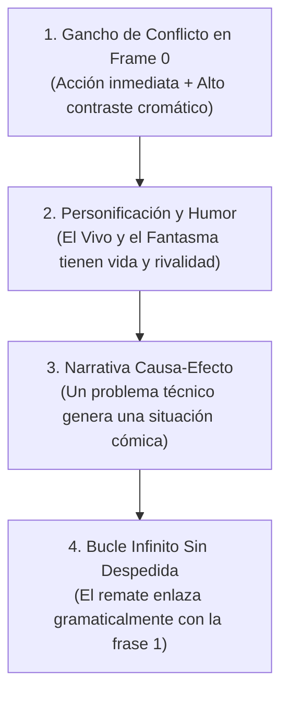

# Kinior Devlog Shorts — Fórmula de Producción y Viralidad

Esta skill recopila la metodología exacta, el estilo de edición, la psicología de retención y las directrices técnicas desarrolladas y validadas con métricas reales en el canal **Kinior Labs** (alcanzando más de **26.000 vistas, 81.9% de elección en feed y más de 100% de retención**).

---

## 1. La Fórmula Innegociable (Los 4 Pilares)



### 1.1. Gancho de Conflicto en Frame 0 (Target: >80% VVSA)
El porcentaje de usuarios que deciden quedarse a ver el video en lugar de deslizar (*Viewed vs Swiped Away - VVSA*) es el filtro que decide si un video se queda en 1.500 vistas o supera las 25.000+:
- **Acción en el milisegundo 1:** Arrancar *in media res* (el personaje cayendo, siendo tragado por un tornado, o en medio de un golpe devastador).
- **Prohibido el gancho pasivo/expositivo ("Le puse X a mi juego..."):** 
  - ❌ *Anti-patrón repetitivo:* *"Le puse un jefe a mi juego..."*, *"Le agregué enemigos a mi juego..."*, *"Le metí físicas a mi juego..."*. Empieza frío, suena a bitácora de notas y aburre al espectador habitual.
  - ✔️ *Ganchos activos y dramáticos:*
    - **El error fatal:** *"Crear el primer jefe de mi juego fue un error... porque ahora destruye a mis personajes de un solo golpe."*
    - **El contraste trágico:** *"Mientras el jugador vivo sufría en cada plataforma... el fantasma se la pasaba de vacaciones."*
    - **La consecuencia física directa:** *"Mis personajes caían como bloques de cemento... así que decidí convertirlos en caricatura."*
    - **La respuesta directa al comentario:** *"Me dijeron que solo hacía sufrir al fantasma... hoy le tocó al vivo."*
- **Texto superior de alto impacto:** Frase corta en mayúsculas, fuente gruesa (*The Bold Font* o similar) con borde negro grueso. Ejemplos: `PRIMER JEFE: ERROR FATAL 💀`, `MIENTRAS EL JUGADOR SUFRÍA`, `EL FANTASMA VIVÍA FELIZ...`.

### 1.2. Personificación de Personajes (Lore y Dinámica)
La audiencia no conecta con "nodos de Godot" ni "hitboxes de colisión"; conecta con la relación entre los personajes:
- **Voz del Narrador (Perspectiva del Desarrollador / Tercera Persona Estricta):**
  - El creador habla siempre como el **desarrollador / observador externo** que construye el juego y mira cómo sus dos personajes interactúan o sufren.
  - **PROHIBIDO narrar en primera persona encarnando a los personajes** (*"mi suelo"*, *"yo me meto al cañón"*).
  - **PROHIBIDO resbalar a la segunda persona como tutorial de gameplay** (*"si calculas mal te pegan"*, *"vuelves a empezar de cero"*). El espectador no está jugando todavía; está viendo una minihistoria:
    - ❌ *Incorrecto (2ª persona):* *"si calculas mal el salto, el gigante te mete un manotazo y vuelves al inicio."*
    - ✔️ *Correcto (3ª persona):* *"si el salto falla o se desincronizan un segundo... el gigante les mete un manotazo y los manda de regreso al inicio."*
- **El Fantasma ("El Petateado"):** Se le trata como un ente que se la pasa de vacaciones, en modo pacífico, o que busca venganza si lo molestan.
- **El Jugador Vivo:** Es el personaje que sufre, salta al vacío con miedo, o actúa como el consentido descansando en una silla playera.
- **La Rivalidad:** La clave cómica es que ambos dependen del otro, pero la tentación de trollear o vengarse siempre está presente.

### 1.3. Narrativa Causa-Efecto y la Regla del "Conflicto Único" (Evitar la Caída del Segundo 22)
Nunca estructurar el video como una adición de mecánicas independientes ("hoy hice A, y además hice B"). Debe ser una sola línea dramática de principio a fin:
$$\text{Problema A} \longrightarrow \text{Solución Imprudente} \longrightarrow \text{Problema Cómico B (Consecuencia)} \longrightarrow \text{Solución Final}$$

> [!WARNING]
> **El Quiebre del Segundo 22 (El Síndrome del "Además..."):**
> Si en el segundo 20–22 dices *"Pero la mejor parte es..."* o cambias de objeto/mecánica sin que sea una consecuencia directa del primer caos, **la retención se desploma**. El espectador asume que la idea principal ya terminó, que lo que sigue es relleno o contenido secundario, y desliza.
>
> - **Anti-Patrón (Provoca abandono a los 22s):** Prometer posesión de plataformas (0–20s) ➡️ Salto no conectado: *"Pero la mejor parte es el cañón..."* (22s). Parecen dos videos pegados con cinta.
> - **Patrón Ganador (30k+ Vistas):** El fantasma estaba aburrido ➡️ Le metí tornados ➡️ *Consecuencia directa:* *"Pero cada vez que el tornado te mandaba a volar, tu compañero no sabía dónde habías caído..."* ➡️ Nace la necesidad inevitable del Rayo X. La segunda mitad responde al caos de la primera.

#### Reglas de Retención de Contenido:
1. **Una sola idea o conflicto por Short:** Explota al máximo las situaciones absurdas o de peligro de esa mecánica hasta el final. No quemes dos mecánicas potentes en 40 segundos; dale a cada una su propio video (ej. el cañón merecía su propio Short dedicado).
2. **Conectar con "Consecuencia Directa" en vez de "Además":** La segunda parte debe ser una reacción inevitable al desastre de la primera.
3. **Velocidad frente a Curiosidad:** Ir demasiado rápido explicando dos cosas distintas impide que la audiencia saboree el trolleo, el peligro o el fallo cómico. Es mejor profundizar en el caos de una sola cosa que resumir dos.

### 1.4. Bucle Infinito Sin Despedida (Target: >95% Retención)
- **Cero despedidas:** Prohibido decir *"gracias por ver"*, *"sígueme para más"*, o *"nos vemos en el próximo video"*. En cuanto el usuario detecta que el video terminó, desliza en los últimos 3 segundos y arruina la gráfica de retención.
- **La Regla del Cierre (Loop de Retención vs. Disparador de Comentarios):**
  - **Prioridad A — Retención y Bucle Máximo (Recomendado en videos visuales/físicas):** No hacer preguntas reflexivas al final. Si le pides al espectador que piense una respuesta, frenas el trance y destruyes la repetición automática. Termina con una frase incompleta que conecte gramaticalmente sin frenar.
  - **Prioridad B — Debate y Comentarios (En decisiones de diseño/trampas):** Si el objetivo es que la gente comente, haz una pregunta binaria clara sin forzar un bucle roto (*"¿Cuál quedó mejor: A o B?"*).
  - **Prohibido los Cierres Híbridos / Frankenstein:** Prohibido mezclar ambas a medias (hacer una pregunta y luego meter un corte de loop forzado como *"...¿serías capaz de pasarlo? no olvides que..."*). Destruye tanto la llamada a la acción como el bucle.
- **Variedad de Conectores de Bucle (Prohibido repetir "Porque antes de esto..."):**
  - Si terminas todos los videos diciendo la misma muletilla (*"porque antes de esto..."*), el espectador habitual anticipa el truco y la fórmula se desgasta.
  - Alterna entre distintos puentes gramaticales según el gancho de inicio:
    - **Puente de advertencia:** `"...parece casi imposible de ganar, sobre todo si recuerdas que..." ➡️ [Corte al segundo 0]` `"crear el primer jefe de mi juego fue un error..."`
    - **Puente de contraste:** `"...aunque me costó varios dolores de cabeza llegar a esto, porque al principio..." ➡️ [Corte al segundo 0]` `"mis personajes caían como bloques de cemento..."`
    - **Puente de causa:** `"...y ahora los dos viven con paranoia constante, todo porque..." ➡️ [Corte al segundo 0]` `"le di al fantasma el poder de poseer objetos..."`
    - **Puente irónico:** `"...así que la próxima vez que los veas tan tranquilos, recuerda que..." ➡️ [Corte al segundo 0]` `"el fantasma vivía feliz... hasta hoy."`

### 1.5. Principio del Espectador Nuevo (100% Autoconclusivo)
Más del **85% de la audiencia de cada Short llega de usuarios nuevos** que jamás han visto un video del canal.
- **Prohibido asumir contexto previo:** Nunca depender de chistes internos o referencias a videos anteriores (como *"por lo que pasó en el video pasado"* o *"como ya saben..."*) a menos que el chiste se entienda completamente por sí solo dentro de los 40 segundos del video actual.
- **Identidad implícita, nunca expositiva:** El espectador debe entender de forma natural que eres el creador del juego mediante tus acciones y tu forma de hablar (*"le agregué...", "programé..."*), sin perder jamás tiempo diciendo frases aburridas como *"hola, soy desarrollador y este es mi juego..."*.
- **Valor de entretenimiento autónomo:** Cada Short debe funcionar como un sketch o minihistoria completa, divertida y satisfactoria para alguien que acaba de instalar YouTube o TikTok hace 5 minutos.

### 1.6. Alquimia del Entretenimiento: Cero Jerga Técnica, Máxima Naturalidad
Cualquier mecánica, sistema o mejora (por más técnica, matemática o simple que sea) debe traducirse en **conflicto humano, física torpe o situación de peligro divertida**:
- **Cero conceptos raros:** Prohibido usar tecnicismos innecesarios (shaders, baking, booleanos, blend trees, interpolación, state machines). Si hablas de un shader de silueta, dilo como *"efecto de rayos X para no perderlo"*. Si hablas de físicas de inercia, dilo como *"si frena de golpe sale volando"*.
- **Lenguaje cotidiano y cercano:** El tono debe sonar como si le estuvieras mostrando algo gracioso a un amigo en persona: directo, espontáneo, con ironía sana y sin palabras pretenciosas.
- **Encontrar el núcleo cómico de cualquier idea:**
  - ¿Un botón de pausa? ➡️ *"Un botón para congelar el sufrimiento de mi amigo."*
  - ¿Un objeto con físicas? ➡️ *"Un taxi manejado por alguien sin licencia."*
  - ¿Un enemigo que patrulla? ➡️ *"Un vecino tóxico con ganas de bronca."*
  - ¿Plataformas temporales? ➡️ *"Un piso que te odia si te quedas quieto."*

---

## 2. Estilo de Edición Visual y Diseño de Sonido

### 2.1. Regla del Contraste Cromático y Zonas Seguras (Safe Zones)
- **Vivo (Amarillo brillante):** NUNCA colocarlo sobre fondos amarillos, arena clara o interfaces beige con texto amarillo. Debe contrastar contra fondos oscuros, roca, azul o follaje verde/otoño oscuro.
- **Fantasma (Azul / Cian espectral):** Resalta con su shader de aura luminosa sobre fondos oscuros o cálidos.
- **Texto en Pantalla:** Siempre con contorno negro de alto contraste (mínimo 8-12px de trazo) o caja de fondo para que sea 100% legible en pantallas móviles pequeñas.
- **Zonas Seguras de la Interfaz (Evitar el solapamiento de la UI):**
  - La interfaz de YouTube Shorts, TikTok y Reels tapa hasta un **20%–25% de la pantalla**:
    - **Margen Inferior (20%):** Ocupado por el nombre del canal, título y audio. No colocar ahí texto importante ni personajes.
    - **Margen Derecho (15%):** Ocupado por los botones de Like, Comentarios y Compartir.
    - **Zona de Oro:** Toda la acción clave, subtítulos principales y gags visuales deben situarse en el **tercio central de la pantalla (área segura de 1080x1400 px)**.

### 2.2. Ritmo de Cortes y Puntuación Cómica
- **Frecuencia de corte:** Cambiar de ángulo de cámara, zoom (*punch-in*) o plano cada **1.5 a 2.5 segundos**.
- **La Regla de Tres en Comedia:** Estructurar los fallos o consecuencias en grupos rítmicos de tres.
  - *Ejemplo probado:* *"Si es muy lento, se cae; si frena, se cae; si el fantasma se enoja... se cae."*
  - Cada una de las tres frases debe ir acompañada de un corte con zoom y un sonido de golpe/caída distinto.
- **Pico cómico al segundo 12-15:** Meter un micro-gag a mitad del video (por ejemplo, romper la cuarta pared con una forma rara en el mapa y decir *"¡noo!"*) para reiniciar la atención del espectador antes de que decida deslizar.

### 2.3. Jerarquía y Niveles de Audio
| Pista | Nivel en dB | Porcentaje en Editor | Función |
| :--- | :--- | :--- | :--- |
| **Voz en Off** | `0 dB` a `-4 dB` | `100% - 130%` | Prioridad absoluta; dicción rápida, limpia y enérgica. |
| **Música de Fondo** | `-20 dB` a `-26 dB` | `8% - 12%` | Ritmo synthwave / lofi gamer; nunca debe competir con las frecuencias medias de la voz. |
| **Efectos de Sonido (SFX)** | `-10 dB` a `-14 dB` | `30% - 40%` | Subrayar golpes, caídas, clics de Blender, chasquidos y remolinos. |

> [!TIP]
> **Variedad en el Gancho de Audio (Evitar la Predictibilidad):**
> No uses la misma entrada en todos los videos para no fatigar a tus espectadores habituales. Rota entre 3 estilos de apertura:
> 1. **El Beat Drop (Estándar):** Audio atenuado en 0:00–0:02; suelta el ritmo con volumen pleno y un *whoosh* o impacto en el segundo 0:02.
> 2. **Inicio Seco (ASMR / SFX puro de juego):** Sin música los primeros 2 segundos; solo el sonido del juego (un crujido seco, un golpe, o el viento) seguido del primer comentario sarcástico.
> 3. **Diálogo Cómico Inmediato:** Entrar directamente con la voz en seco sobre la acción antes de que comience cualquier melodía.

---

## 3. Duración y Métricas Objetivo

- **Flexibilidad en la Duración (El Ritmo manda sobre el Cronómetro):**
  - **Formato Micro-Gag / Pulido Visual (22 a 28 segundos):** Para ideas muy concretas (ej. un antes/después de partículas o un bug gracioso). No estirar artificialmente con relleno; un video de 25s que vuela logra >110% de retención fácilmente.
  - **Formato Narrativa Causa-Efecto (35 a 42 segundos):** Para historias con evolución (ej. tornados ➡️ rayos X, islas flotantes ➡️ caída contrarreloj).
  - **Alerta roja (>48 segundos):** Salvo que la tensión dramática sea extrema, superar los 50 segundos reduce exponencialmente la probabilidad de retención por encima del 80%.
- **Metas de Métricas en YouTube Studio:**
  - **Se quedaron para mirar (VVSA):** $\ge 75\%$ (Óptimo: $>80\%$).
  - **Duración promedio de vistas:** $\ge 90\%$ del video.
  - **Retención inicial en segundo 0:** $>140\%$ (demuestra que el bucle funciona).

---

## 4. Guía de Publicación Multiplataforma

### 4.1. YouTube Shorts
- **Título:** Máximo 50-70 caracteres. Sin saturar de hashtags (máximo 1 o 2 clave como `#gamedev #indiegame`).
  - *Fórmulas probadas:* `[Personaje] vivía feliz... hasta hoy 🌪️💀`, `Me dijeron que consentía mucho a [Personaje]... 💀🎮`.
- **Descripción:** Formato estándar Kinior Labs:
  1. Gancho de una línea con emojis.
  2. Párrafo corto explicando el reto técnico / mecánico sin aburrir.
  3. Pregunta abierta que incite debate en comentarios.
  4. Ficha técnica (`Motor: Godot Engine 4.x`, `Modelado: Blender 5.x`).
  5. 6 a 8 hashtags organizados.
- **Comentario Fijado:** Publicar inmediatamente una pregunta polarizante para incentivar respuestas en los primeros 30 minutos.
- **Miniatura (Frame Selector):** Seleccionar manualmente un fotograma con alto contraste, expresión cómica de personaje o texto de impacto.

### 4.2. TikTok
- **Texto:** Breve, informal, usando llamadas a etiquetar amigos (*"Etiqueta a ese amigo que..."*).
- **Portada:** Texto grueso centrado con el chiste principal (*«MODO VACACIONES CANCELADO 💀»*).
- **Hashtags:** Exactamente 5 de alto impacto (`#gamedev #indiegame #godotengine #devlog #videojuegos`).

### 4.3. Instagram Reels
- **Enfoque:** Enfocado en la compartibilidad directa por mensaje privado (DM) para parejas o amigos que juegan cooperativos.
- **Hashtags:** Exactamente 5 hashtags para evitar limitaciones de cuenta (`#gamedev #indiegame #godotengine #devlog #videojuegos`).

---

## 5. Plantilla Maestra para Nuevos Guiones

Al escribir un nuevo guion para Kinior Labs, utiliza siempre esta estructura flexible evitando muletillas repetitivas:

```markdown
### 🎙️ Texto Corrido (~120 - 150 palabras / ~25 - 40 segundos según complejidad):
1. [Gancho ACTIVO y dramático en Frame 0 — Prohibido "Le puse X a mi juego..."]...
2. [El contraste cómico o problema inicial entre el Vivo y el Fantasma en 3ª persona].
3. [El desarrollo del conflicto único o el intento fallido / bug cómico].
4. [La consecuencia en cadena explicada con regla de tres y acción dinámica].
5. [El cierre elegido: Bucle milimétrico con conector variado O pregunta binaria clara — Nunca híbrido].
```

### Tabla de Desglose para Grabación y Edición:
| Tiempo | Toma / Visual (Lo que se graba) | Locución (Lo que se dice) | SFX / Edición |
| :--- | :--- | :--- | :--- |
| **0:00 - 0:03** | Acción o gag visual inmediato (alto contraste, zona segura). | Frase activa / drama o error fatal. | *Impacto seco / Beat drop / Inicio SFX* |
| **0:03 - 0:12** | Comparativa del estado inicial (Vivo vs Fantasma). | El problema o contraste de roles. | *Música base toma ritmo* |
| **0:12 - 0:24** | El intento / la mecánica en acción en el mapa. | La tensión o el bug cómico intermedio. | *Zoom punch-in / micro-gag* |
| **0:24 - 0:34** | Consecuencias dinámicas de la acción. | Regla de tres en tercera persona. | *Sonidos cómicos sincronizados* |
| **0:34 - 0:40** | Remate visual o reacción en el spawn. | Conector variado que enlaza al segundo 0. | *Corte seco milimétrico sin despedida* |

---

## 6. Historial de Aprendizajes de la Audiencia de Kinior Labs

1. **La comunidad responde a los comentarios en video:** La serie creció drásticamente cuando se incorporaron capturas de comentarios reales de la comunidad (`@EthanVillalobos`, `@JuanNarvaez`, `@zmusic`).
2. **Alternancia de protagonistas:** Mantener la rotación entre videos dedicados al **Vivo** y videos dedicados al **Fantasma** equilibra el desarrollo y mantiene viva la rivalidad cómica.
3. **El espectador de Shorts busca entretenimiento primero, código después:** No explicar líneas de código ni estructuras de árboles de nodos; mostrar el efecto visual y el impacto en la jugabilidad.
4. **Caso de Estudio: Video de 30k vs Quiebre del Segundo 22:**
   - **Video de 30k (`El fantasma vivía feliz... hasta hoy`):** Sostuvo retención uniforme porque los tornados desencadenaron la necesidad de los rayos X como solución a un problema que el espectador acababa de ver.
   - **Video con caída a los 22s (`Le di a mi fantasma el poder de poseer cosas...`):** La audiencia se desconectó al segundo 20–22 al cambiar de plataformas a cañón con *"Pero la mejor parte es..."*. La audiencia sintió que el video ya había entregado su promesa inicial.
   - **Lección clave:** Menos mecánicas por video = mayor desarrollo del conflicto, mejor comedia y mayor retención. Si una mecánica es buena (como el cañón), se guarda para protagonizar su propio Short.
