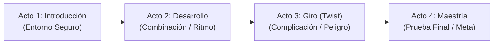
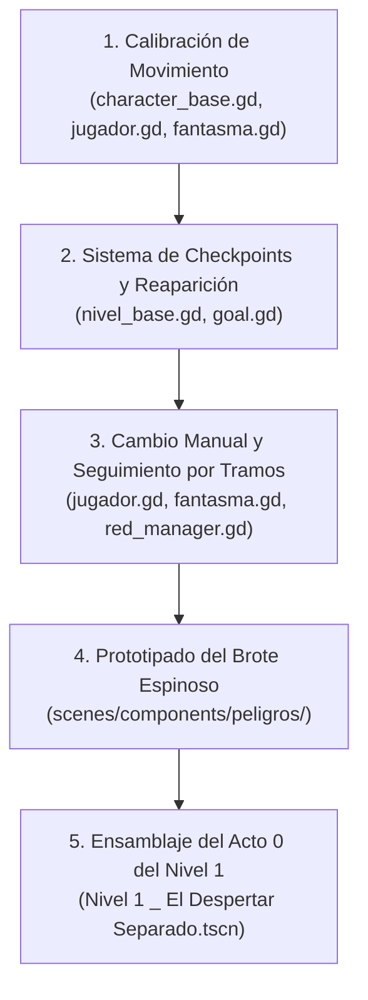

# Documento de Diseño de Niveles (Level Design GDD) - Proyecto Limbo

**Versión:** 1.0  
**Fecha:** Noviembre 2026  
**Estado:** Documento de Referencia Oficial  
**Relación:** Complemento técnico de `plan_limbo_consolidado.md` y `DOCUMENTACION_LIMBO.md`.

---

## 1. Lineamientos Fundamentales de Diseño

### 1.1 Filosofía y Asimetría
Proyecto Limbo es un juego de plataformas y puzzles cooperativo asimétrico. Ningún nivel puede ser superado por un personaje en solitario sin la intervención de las facultades del otro:
- **Jugador Vivo:** Manipulación física del entorno (empujar cajas, pisar botones de presión, girar manivelas, halar palancas, romper muros con ayuda externa), movimiento ágil terrestre con **doble salto** y control de inercia preciso.
- **Fantasma:** Manipulación del plano espiritual (activación y retracción temporal de plataformas con el **Aura**, **posesión** de objetos mecánicos/espectrales), movilidad aérea con **salto largo único** y **planeo suspendido** al mantener presionado el botón de salto.

### 1.2 Reglas del Modo Solo (Manual con Seguimiento por Tramos)
1. **Sin teletransporte automático:** Los personajes avanzan por tramos delimitados. El compañero inactivo sigue automáticamente al activo a una distancia corta (≈ 2–3 m) mientras el terreno lo permita.
2. **Puntos de Bloqueo (`PuntoCambio`):** Cada tramo culmina en un obstáculo infranqueable para el seguidor (abismo espiritual, puerta cerrada, plataforma que requiere Aura, cañón que requiere posesión). En este punto el seguidor se frena, se activa el indicador visual sobre su cabeza y el botón de cambio de personaje pulsa en el HUD.
3. **Persistencia de Estados:** Al alternar, el estado anterior (plataforma poseída, temporizador del Aura, botón accionado) se preserva intacto.
4. **Seguridad del Inactivo:** El compañero inactivo es invulnerable a peligros y enemigos mientras espera o sigue en tramos seguros.
5. **Reaparición conjunta:** Si el personaje activo cae al vacío o es impactado por un peligro, **ambos personajes reaparecen juntos en el último checkpoint** activado.

### 1.3 Estructura Estándar de Nivel (Método Kishōtenketsu en 4 Actos)
Cada nivel tiene una duración estimada de **3 a 5 minutos** y se compone de 4 actos claramente diferenciados, con un checkpoint al inicio de cada uno:

- **Acto 1 (Introducción):** Se presenta el elemento central del nivel en un contexto donde el error no resulte letal.
- **Acto 2 (Desarrollo):** Se combina con mecánicas preexistentes (ej. plataformas de colapso, botones físicos).
- **Acto 3 (Giro):** Se añade una variable de presión o inversión (un enemigo específico, temporizador natural, separación visual).
- **Acto 4 (Maestría):** Prueba integrada de máxima sincronización antes de alcanzar la zona del brillo final.

### 1.4 Guía Visual y Meta Implícita
- **Sin flechas ni marcadores de interfaz artificiales.**
- **Luz de Meta:** Un foco de alta emisión volumétrica visible desde cotas elevadas del nivel que marca el norte geográfico.
- **Rastros cromáticos:** Monedas doradas (`moneda_vivo`) delinean las parábolas de salto del Vivo; monedas cian (`moneda_fantasma`) marcan los vectores de planeo del Fantasma.
- **Gemas Espirituales (`gema_espiritual`):** Cantidad variable por nivel. Funcionan como balizas visuales para señalar caminos alternativos, terrazas elevadas o atajos de habilidad para ambos personajes.

---

## 2. Catálogo Maestro de Niveles (12 Niveles en 6 Zonas)

### Zona 1: Praderas y Ruinas (Tutorial y Encuentro)
- **Paleta visual:** Praderas doradas y cielos diurnos cálidos (Vivo) en contraste con bloques de mampostería antigua y neblina azulada (Fantasma).

#### Nivel 1: "El Despertar Separado"
- **Identificador de escena:** `res://scenes/levels/Nivel 1 _ El Despertar Separado.tscn`
- **Tema:** *Pradera con toques de ruinas* (entorno dominante del Vivo).
- **Mecánica central:** Descenso inicial en solitario del Fantasma; cooperación básica física/espiritual tras el encuentro.
- **Estructura de Actos:**
  - **Acto 0 (Descenso del Fantasma):** El Fantasma despierta en lo alto de la torre en ruinas, observa a lo lejos un destello dorado en la pradera (el Vivo, sin saber aún quién es) y desciende planeando entre corrientes y esquivando los primeros **Torbellinos** estáticos.
  - **Acto 1 (El Encuentro y Primer Salto):** El Fantasma aterriza en la pradera. Primera barrera: una brecha con plataformas espirituales que requieren el Aura del Fantasma mientras el Vivo cruza.
  - **Acto 2 (Mecanismos Físicos):** El Vivo encuentra una puerta pesada; debe pisar un botón de presión para mantenerla abierta permitiendo que el Fantasma pase al otro lado a activar un `InterruptorAura`.
  - **Acto 3 (El Brote Espinoso):** Introducción del primer peligro del Vivo: plantas espinosas que se abren rítmicamente cada 2 segundos. El Fantasma puede adormecerlas temporalmente con el Aura.
  - **Acto 4 (El Umbral y Desengaño):** Tramo final sobre islas de colapso combinadas con aura. Al llegar a la meta, ambos intentan estrechar sus manos, se traspasan etéreamente y contemplan la ruta hacia el horizonte.
- **Peligros:** Torbellino (solo Fantasma en Acto 0 y 4), Brote Espinoso (solo Vivo en Acto 3).
- **Gemas guía:** 3 gemas situadas en arcos de salto y sobre una repisa opcional de ruinas.
- **Idea para Short / Devlog:** *"Mi fantasma baja de su torre: planeo, torbellinos y el encuentro final."*

#### Nivel 2: "El Camino del Faro"
- **Identificador de escena:** `res://scenes/levels/nivel 2.tscn`
- **Tema:** *Ruinas con toques de pradera* (entorno dominante del Fantasma).
- **Mecánica central:** Sincronización rítmica de Aura y mecanismos de palancas y manivelas continuas.
- **Estructura de Actos:**
  - **Acto 1 (Arquitectura Elevada):** Salto largo y planeo del Fantasma para cruzar vanos de arquería derrumbada; el Vivo utiliza rampas de piedra y doble salto.
  - **Acto 2 (Manivelas y Puentes Espectrales):** El Vivo debe girar una `ManivelaContinua` para alinear un puente físico mientras el Fantasma sostiene la tangibilidad de las barandas con el Aura.
  - **Acto 3 (Brotes Alternados y Luciérnaga):** Sala con brotes espinosos en frecuencias desfasadas y la aparición de una `LuciernagaCazadora` suave que acecha al Fantasma, disuadida por la luz de los faroles que enciende el Vivo.
  - **Acto 4 (Jefe de Zona: Centinela Hueco):**
    - *Fase 1:* El Centinela persigue lentamente al Vivo; el Fantasma debe envolverlo en su Aura para tornarlo tangible.
    - *Fase 2:* El Vivo acciona una palanca para soltar un contrapeso de piedra sobre la cabeza del Centinela tangible.
    - *Fase 3:* Tercer impacto mediante salto y aplastamiento (*ground pound*) directo sobre el núcleo expuesto.
- **Peligros:** Brotes espinosos alternados, Luciérnaga Cazadora, Centinela Hueco.
- **Gemas guía:** 4 gemas que marcan el camino entre las columnas superiores de las ruinas.
- **Idea para Short / Devlog:** *"Creamos el primer jefe del juego: cómo derrotar a una armadura gigante cooperando."*

---

### Zona 2: Montaña Ventosa (Separación y Corrientes)
- **Paleta visual:** Riscos escarpados grises, cañones profundos, vórtices de polvo y nubes bajas en constante turbulencia.

#### Nivel 3: "La Gran Montaña"
- **Identificador de escena:** `res://scenes/levels/nivel_3_la_montana.tscn`
- **Tema:** Separación física absoluta por vendaval.
- **Mecánica central:** Rutas paralelas (Exterior vs. Interior) con ventanas de comunicación cooperativa.
- **Estructura de Actos:**
  - **Acto 1 (El Muro de Viento):** La entrada al paso montañoso presenta torbellinos huracanados que impiden el vuelo exterior del Fantasma. El Fantasma ingresa a las cavernas interiores; el Vivo bordea las cornisas exteriores.
  - **Acto 2 (Ventana 1 - La Compuerta de Piedra):** El Vivo encuentra una puerta cerrada en el exterior. A través de una reja en la roca, ve al Fantasma dentro, quien debe saltar sobre plataformas espirituales para bajar una palanca interior.
  - **Acto 3 (Ventana 2 - El Escarabajo y el Farol):** El Vivo enfrenta en las repisas a un `EscarabajoPetreo` (esperar a que asome tras rodar); el Fantasma adentro activa desde una grieta un interruptor de luz que ilumina la caverna y revela apoyos exteriores.
  - **Acto 4 (Reencuentro en la Cumbre):** El túnel interior desemboca en la cresta de la montaña. Ambos personajes se reúnen en la cima con vista al mar de nubes.
- **Peligros:** Torbellinos exteriores masivos (anulan vuelo), Escarabajos Pétreos (repisas del Vivo).
- **Gemas guía:** 4 gemas (2 en la ruta exterior del Vivo, 2 en el sistema de túneles del Fantasma).
- **Idea para Short / Devlog:** *"Un nivel, dos caminos: el Vivo escala por fuera, el Fantasma cruza por dentro."*

#### Nivel 4: "El Ascenso del Vendaval"
- **Identificador de escena:** `res://scenes/levels/nivel_4_el_ascenso_del_vendaval.tscn`
- **Tema:** Dominio conjunto de corrientes aéreas.
- **Mecánica central:** Corrientes de viento ascendentes y laterales activables; introducción del Espectro tangible y el Gólem de piedra.
- **Estructura de Actos:**
  - **Acto 1 (Corrientes de Impulso):** Vórtices de viento blanco benignos. El Fantasma activa la corriente con el Aura; el Vivo se eleva como en un elevador neumático para alcanzar mesetas altas.
  - **Acto 2 (El Espectro Acechante):** Primer encuentro con el `EnemigoEspectral`. Se manifiesta en la plataforma del Vivo; el Fantasma debe acudir rápidamente con el Aura para volverlo tangible y permitir que el Vivo lo aplaste.
  - **Acto 3 (El Despertar del Gólem):** El Vivo golpea accidentalmente un mecanismo que despierta a un `GolemPiedra`. El Fantasma se lanza en picada y **posee al Gólem**, usándolo para demoler un muro agrietado gigantesco y abrir paso al Vivo.
  - **Acto 4 (Jefe de Zona: Ojo del Vendaval):**
    - *Fase 1:* El vórtice gigante genera ondas de choque concéntricas; esquivar planeando y saltando.
    - *Fase 2:* El Fantasma monta una corriente lateral para sobrevolar el ojo del tornado y desactivar su vórtice protector con el Aura.
    - *Fase 3:* El Vivo es proyectado por la corriente central y ejecuta un pisotón sobre el corazón de piedra de la tormenta.
- **Peligros:** Enemigo Espectral, Corrientes de choque, Ojo del Vendaval.
- **Aliados poseíbles:** Gólem de Piedra.
- **Gemas guía:** 5 gemas ubicadas a lo largo de las corrientes de viento.
- **Idea para Short / Devlog:** *"Poseer a un Gólem de piedra gigante para destrozar obstáculos."*

---

### Zona 3: Bosque del Faro (Posesión y Luces)
- **Paleta visual:** Follaje otoñal rojizo y dorado denso, troncos retorcidos, niebla mística a ras de suelo y farolas antiguas.

#### Nivel 5: "Las Raíces Brumosas"
- **Identificador de escena:** `res://scenes/levels/nivel_5_las_raices_brumosas.tscn`
- **Tema:** Introducción de vehículos espirituales en entornos boscosos.
- **Mecánica central:** Posesión avanzada de la `PlataformaTaxi` y `CanonEspiritual`.
- **Estructura de Actos:**
  - **Acto 1 (El Taxi sobre el Pantano):** Una ciénaga insondable bloquea el paso del Vivo. El Fantasma posee la Plataforma Taxi; el Vivo aborda y juntos navegan esquivando raíces espinosas.
  - **Acto 2 (Artillería Espiritual):** El Vivo ingresa en la recámara de un Cañón Espiritual; el Fantasma posee el cañón, calibra pitch y yaw, y dispara al Vivo hacia una fortaleza en un risco.
  - **Acto 3 (Sombras en la Espesura):** Aparición de la `SombraAcechante` que persigue al Vivo en zonas oscuras. El Vivo debe transportar una antorcha o apoyarse en farolas fijas.
  - **Acto 4 (Coordinación Balística):** El Vivo activa desde la torre una palanca que desbloquea la compuerta de salida del Taxi del Fantasma para llegar juntos a la meta.
- **Peligros:** Sombras Acechantes, Raíces Espinosas, Centinelas de Luz en troncos.
- **Objetos poseíbles:** Plataforma Taxi, Cañón Espiritual.
- **Gemas guía:** 4 gemas flotando en las parábolas de disparo del cañón.
- **Idea para Short / Devlog:** *"Convirtiendo a mi amigo en bala de cañón con posesión espiritual."*

#### Nivel 6: "El Faro Ancestral"
- **Identificador de escena:** `res://scenes/levels/nivel_6_el_faro_ancestral.tscn`
- **Tema:** El corazón del bosque y la torre del faro.
- **Mecánica central:** El `FarolEspiritual` giratorio que revela senderos ocultos y quema sombras.
- **Estructura de Actos:**
  - **Acto 1 (El Faro Espectral):** El Fantasma posee el Farol rotatorio del faro; al proyectar el haz de luz mística, materializa puentes invisibles para que el Vivo avance.
  - **Acto 2 (Engranajes de Molienda):** El Fantasma posee un `EngranajeEspiritual` para desacelerar una serie de ruedas dentadas gigantescas de piedra por donde el Vivo debe trepar.
  - **Acto 3 (El Asedio de Sombras):** Múltiples Sombras Acechantes atacan mientras el Vivo cruza un puente estrecho; el haz del farol debe barrer el área en tiempo exacto.
  - **Acto 4 (Jefe de Zona: Raíz Madre):**
    - *Fase 1:* La Raíz Madre cubre el escenario de raíces espinosas y oscuridad.
    - *Fase 2:* El Fantasma posee el Farol para focalizar luz en los 3 bulbos fotosensibles del monstruo.
    - *Fase 3:* Cada bulbo iluminado se vuelve vulnerable; el Vivo los destruye disparándose desde cañones cercanos.
- **Peligros:** Raíz Madre, Sombras Acechantes, Centinelas de Luz.
- **Objetos poseíbles:** Farol Espiritual, Engranaje Espiritual, Cañón.
- **Gemas guía:** 5 gemas colocadas sobre las pasarelas reveladas únicamente por la luz del farol.
- **Idea para Short / Devlog:** *"Un faro que revela caminos secretos en un bosque encantado."*

---

### Zona 4: Minas de Cristal (Resonancia y Reflexión)
- **Paleta visual:** Cavernas profundas en tonos azul cobalto y violeta, con cristales luminiscentes gigantescos que tintinean al tacto.

#### Nivel 7: "Las Cavernas Resonantes"
- **Identificador de escena:** `res://scenes/levels/nivel_7_las_cavernas_resonantes.tscn`
- **Tema:** Acústica y refracción mística.
- **Mecánica central:** Cristales de Resonancia que reflejan y amplifican el pulso del Aura.
- **Estructura de Actos:**
  - **Acto 1 (El Prisma Místico):** El Fantasma activa el Aura junto a un `CristalEco`; el cristal retransmite el radio de activación a un segundo cristal lejano, abriendo plataformas distantes para el Vivo.
  - **Acto 2 (Señuelos de Cristal):** El `GusanoCristal` bloquea el suelo del Vivo. El Fantasma pulsa con el Aura un racimo de "manzanas de cristal" (señuelos resonantes); el gusano se distrae devorando el cristal y libera el paso.
  - **Acto 3 (Espinas de Refracción):** Campos de espinas de luz violeta letales para el Fantasma; el Vivo debe mover vagonetas mineras y bloques pesados para bloquear los haces de luz.
  - **Acto 4 (La Cámara de Ecos):** Serie de tres cristales que deben ser activados en cadena armónica para sostener una plataforma móvil colosal.
- **Peligros:** Gusano de Cristal, Espinas de Luz violeta.
- **Gemas guía:** 4 gemas situadas en recovecos de cristal reflectante.
- **Idea para Short / Devlog:** *"Engañando a un gusano gigante con manzanas de cristal resonantes."*

#### Nivel 8: "El Corazón Cristalino"
- **Identificador de escena:** `res://scenes/levels/nivel_8_el_corazon_cristalino.tscn`
- **Tema:** El núcleo geológico de la mina.
- **Mecánica central:** Orientación de prismas reflectores y manipulación de engranajes.
- **Estructura de Actos:**
  - **Acto 1 (Alineación de Facetas):** El Vivo gira manivelas físicas para rotar pedestales de cristal; el Fantasma dispara ondas de aura que rebotan en ángulo recto.
  - **Acto 2 (La Red Esmeralda):** Puzzles de sincronía donde una sola emisión de Aura debe alimentar cuatro receptores simultáneamente mediante reflejos.
  - **Acto 3 (Fuga en las Vagonetas):** Descenso rápido en vagoneta donde el Fantasma activa plataformas de riel justo a tiempo.
  - **Acto 4 (Jefe de Zona: Gusano Soberano):**
    - *Fase 1:* El Gusano Soberano emerge del lecho cavernoso destruyendo pilares de roca.
    - *Fase 2:* El Fantasma activa engranajes para levantar señuelos gigantes y canalizar un haz de resonancia múltiple hacia la cabeza del monstruo.
    - *Fase 3:* Con el gusano aturdido en el suelo, el Vivo corre por su lomo de cristal y ejecuta el golpe final en la gema frontal.
- **Peligros:** Gusano Soberano, Espinas de Luz, derrumbes de estalactitas.
- **Gemas guía:** 5 gemas alineadas con los haces de refracción más complejos.
- **Idea para Short / Devlog:** *"Cómo programar físicas de luz y reflejos en Godot 4 para un puzzle cooperativo."*

---

### Zona 5: Cielo Tormentoso (Intercambio y Vértigo)
- **Paleta visual:** Cielo abierto sobre un manto denso de nubes de tormenta, islas flotantes en ruinas desgajadas y relámpagos lejanos.

#### Nivel 9: "El Mar de Nubes"
- **Identificador de escena:** `res://scenes/levels/nivel_9_el_mar_de_nubes.tscn`
- **Tema:** Alturas vertiginosas y transmutación de posición.
- **Mecánica central:** **Intercambio de Lugares** (el Fantasma coloca una marca de teleportación y ambos conmutan posiciones instantáneamente).
- **Estructura de Actos:**
  - **Acto 1 (El Primer Intercambio):** El Fantasma vuela y planea sobre un abismo insalvable hasta una cornisa segura; clava la marca espiritual y activa el intercambio: el Vivo aparece en la cornisa y el Fantasma vuelve al inicio para planear de nuevo.
  - **Acto 2 (La Medusa Trampolín):** Encuentro con la `MedusaNube`. El Fantasma la posee para situarla sobre el vacío; el Vivo salta sobre ella y la utiliza como trampolín elástico para ganar gran altura.
  - **Acto 3 (Pruebas de Relevo):** Zonas con interruptores que solo el Vivo puede pisar situadas en agujas inalcanzables a pie; coordinación de intercambio aéreo.
  - **Acto 4 (Sincronía de Caída):** El Vivo se deja caer al vacío deliberadamente; el Fantasma activa el intercambio en el último segundo para posicionarlo sobre una plataforma sólida inferior.
- **Peligros:** Vértigo/Caída infinita, descargas estáticas.
- **Criaturas poseíbles:** Medusa de Nube.
- **Gemas guía:** 4 gemas suspendidas en trayectorias de rebote de medusa.
- **Idea para Short / Devlog:** *"La mecánica más divertida del juego: intercambiar cuerpos en el aire."*

#### Nivel 10: "Las Ruinas de la Tormenta"
- **Identificador de escena:** `res://scenes/levels/nivel_10_las_ruinas_de_la_tormenta.tscn`
- **Tema:** Palacios derruidos suspendidos en el ojo de la tormenta.
- **Mecánica central:** La `GargolaPiedra` demoledora combinada con intercambio rápido.
- **Estructura de Actos:**
  - **Acto 1 (Plataformas Condenadas):** La Gárgola de piedra despierta; en cuanto el Vivo toca una losa, la gárgola embiste y la pulveriza en 1.5 segundos. Plataformeo a toda velocidad sin detenerse.
  - **Acto 2 (Rescate en Vuelo):** Cuando una losa colapsa irremediablemente con el Vivo encima, el Fantasma utiliza el Intercambio para salvarlo en milésimas de segundo.
  - **Acto 3 (Paralización Espectral):** El Fantasma usa el Aura a quemarropa para petrificar temporalmente a la gárgola mientras el Vivo cruza puentes precarios.
  - **Acto 4 (Jefe de Zona: Gárgola Soberana):**
    - *Fase 1:* La Gárgola Soberana destruye metódicamente las plataformas del ring exterior una por una.
    - *Fase 2:* El Fantasma posee una Medusa de Nube gigante para crear una plataforma flotante móvil segura sobre el vacío.
    - *Fase 3:* Conducción de la medusa hacia la cabeza de la Gárgola, intercambio de emergencia y remate de pisotón del Vivo sobre su corona.
- **Peligros:** Gárgola de Piedra, colapso de terreno, Gárgola Soberana.
- **Gemas guía:** 5 gemas situadas en plataformas de colapso rápido.
- **Idea para Short / Devlog:** *"Un monstruo que destruye el suelo bajo tus pies mientras corres."*

---

### Zona 6: El Limbo (Convergencia y Desenlace)
- **Paleta visual:** Monocromía etérea estilizada, tonos blanco perla, platino y gris pizarra suave. Toda la vegetación y la roca comparten partículas de luz dorada y azul entremezcladas.

#### Nivel 11: "El Último Umbral"
- **Identificador de escena:** `res://scenes/levels/nivel_11_el_ultimo_umbral.tscn`
- **Tema:** El preludio a la fusión de realidades.
- **Mecánica central:** Recapitulación armónica de todas las habilidades aprendidas; introducción de los `Ecos`.
- **Estructura de Actos:**
  - **Acto 1 (Los Ecos del Pasado):** Figuras sombrías translúcidas que reproducen con 2 segundos de retardo los pasos y saltos del jugador; obligan a trazar trayectorias fluidas y sin titubeos.
  - **Acto 2 (La Danza de Mecanismos):** Salas secuenciales que combinan Taxi espectral, corrientes de viento y paneles de resonancia en rápida sucesión.
  - **Acto 3 (Intercambio en el Vacío Puro):** Plataformas invisibles que solo el Fantasma ve con el Aura, requiriendo intercambios de posición continuos sobre el abismo blanco.
  - **Acto 4 (Las Puertas del Limbo):** Apertura simultánea de dos sellos monumentales mediante la sincronización perfecta de ambos seres.
- **Peligros:** Ecos espectrales retardados.
- **Gemas guía:** 6 gemas puras que componen la constelación del umbral.
- **Idea para Short / Devlog:** *"Llegando al Limbo: cuando el juego blanco y negro une todos tus poderes."*

#### Nivel 12: "El Encuentro en el Limbo"
- **Identificador de escena:** `res://scenes/levels/nivel_12_el_encuentro_en_el_limbo.tscn`
- **Tema:** El clímax narrativo y mecánico del juego.
- **Mecánica central:** Enfrentamiento en 5 fases contra **La Soledad** y desenlace interactivo.
- **Estructura de la Batalla y Final:**
  - **Fase 1 (Praderas - Aura y Física):** La Soledad se manifiesta como una silueta gigante mitad dorada, mitad azul. El Fantasma la hace tangible con el Aura; el Vivo activa interruptores para exponer su núcleo.
  - **Fase 2 (Montaña - Vórtice y Viento):** La arena se inunda de corrientes huracanadas; vuelo coordinado esquivando torbellinos y activación de corrientes ascendentes.
  - **Fase 3 (Bosque - Posesión y Cañón):** El Fantasma posee el cañón central de la arena y dispara al Vivo hacia los brazos de la criatura para desarmarla.
  - **Fase 4 (Minas - Resonancia y Reflejo):** Se proyectan haces de cristal que deben ser reflejados con prismas de luz hacia el centro del jefe.
  - **Fase 5 (Cielo - El Intercambio Definitivo):** La arena colapsa por completo; el jugador solo puede sobrevivir encadenando intercambios aéreos y rebotes en medusas hasta alcanzar la esfera central.
  - **Epílogo Interactivo ("Las Manos se Tocan"):**
    - La criatura se disuelve en millones de partículas de luz.
    - El escenario se sosiega en una calma absoluta. Ambos personajes caminan el uno hacia el otro en el centro del Limbo.
    - El jugador toma el control final: caminan hasta quedar frente a frente.
    - Se pulsa el botón de interactuar: sus manos se extienden, esta vez chocan físicamente con un destello suave, se toman de la mano y una onda cálida transforma todo el entorno. Fin del juego.
- **Peligros:** La Soledad (5 fases).
- **Gemas guía:** 1 gema monolítica en el centro del altar del Limbo.
- **Idea para Short / Devlog:** *"El final de Proyecto Limbo: después de 12 niveles, por fin se tocan."*

---

## 3. Checklist de Creación y Validación de Niveles

Antes de dar un nivel por concluido y apto para ser jugado en release o mostrado en devlogs, debe superar esta lista de verificación:

### Fase 1: Prototipado y Greybox (Mallas y Rutas)
- [ ] Escena creada a partir de `res://scenes/levels/plantilla_nivel.tscn` heredando de `NivelBase`.
- [ ] Las 4 áreas de Checkpoint (`AreaCheckpoint_1` a `4`) colocadas y conectadas.
- [ ] Ruta dorada transitable de principio a fin sin arte final (bloques grises o islas base).
- [ ] La meta (Goal) es visible o claramente sugerida por iluminación y geometría desde cotas altas.
- [ ] Colocados los marcadores `PuntoCambio` en cada cuello de botella donde el compañero no pueda seguir.

### Fase 2: Validación Mecánica
- [ ] **Test en Modo Solo:** Superable al 100% alternando manualmente personajes sin atascos de IA seguidora.
- [ ] **Test en Modo Cooperativo:** Jugado fluidamente por 2 personas en red local (LAN P2P) o pantalla dividida.
- [ ] Verificado que la caída o muerte de uno devuelve a ambos sincronizadamente al último checkpoint.
- [ ] Verificado que las gemas y monedas guían la trayectoria natural del salto y planeo.

### Fase 3: Arte, Decoración y Rendimiento Móvil
- [ ] Aplicación de materiales procedimentales de isla (`IslaFlotante`) y follaje con viento.
- [ ] Culling optimizado: los emisores de partículas y mallas críticas no sufren popping indeseado.
- [ ] Tasa de cuadros sostenida a **60 FPS estables** en perfil Mobile Forward en Android de gama media.
- [ ] La cámara en tercera persona (`SpringArm3D`) no penetra muros ni genera oclusiones que desorienten al jugador.

---

## 4. Plan de Acción Técnico - Hito M1 (Núcleo Jugable)

Para comenzar de inmediato con la programación del proyecto, este es el orden de implementación técnica en los scripts del juego:

1. **Movimiento Odyssey:**
   - Afinar aceleración, giros con derrape y fricción en `character_base.gd`.
   - Ajustar coyote time (0.12s) y jump buffer (0.12s).
   - Calibrar el doble salto e impacto de caída en `jugador.gd`.
   - Afinar el planeo sostenido y la flotación de salto largo en `fantasma.gd`.
2. **Checkpoints y Reaparición:**
   - Crear componente reutilizable `Checkpoint.tscn` (`Area3D`).
   - Sincronizar en `NivelBase` el punto de control activo (`posicion_ultimo_checkpoint`).
   - Al caer al vacío o contactar peligro, reiniciar la posición de ambos jugadores en dicho punto con fundido rápido a negro.
3. **Modo Solo (Alternancia y Seguimiento):**
   - Implementar máquina de estados de seguimiento en `CharacterBase`: estado `ACTIVO`, `SIGUIENDO`, `ESPERANDO_BLOQUEO`.
   - Lógica de buffer de posiciones pasadas para que el inactivo camine sobre el rastro del activo a 2.5m de distancia.
   - Detección de nodos `PuntoCambio` para detener al seguidor y emitir señal de cambio requerido a la UI.
4. **Peligros de la Zona 1:**
   - Crear escena `brote_espinoso.tscn` con animación cíclica de apertura/cierre y área de contacto letal para el Vivo.
   - Integración con el Aura del Fantasma para suspender la animación temporalmente.
5. **Acto 0 del Nivel 1:**
   - Extender la escena del Nivel 1 hacia arriba creando la torre en ruinas del Fantasma.
   - Disponer torbellinos estáticos de entrenamiento para descender planeando hacia el punto de spawn del Vivo.
